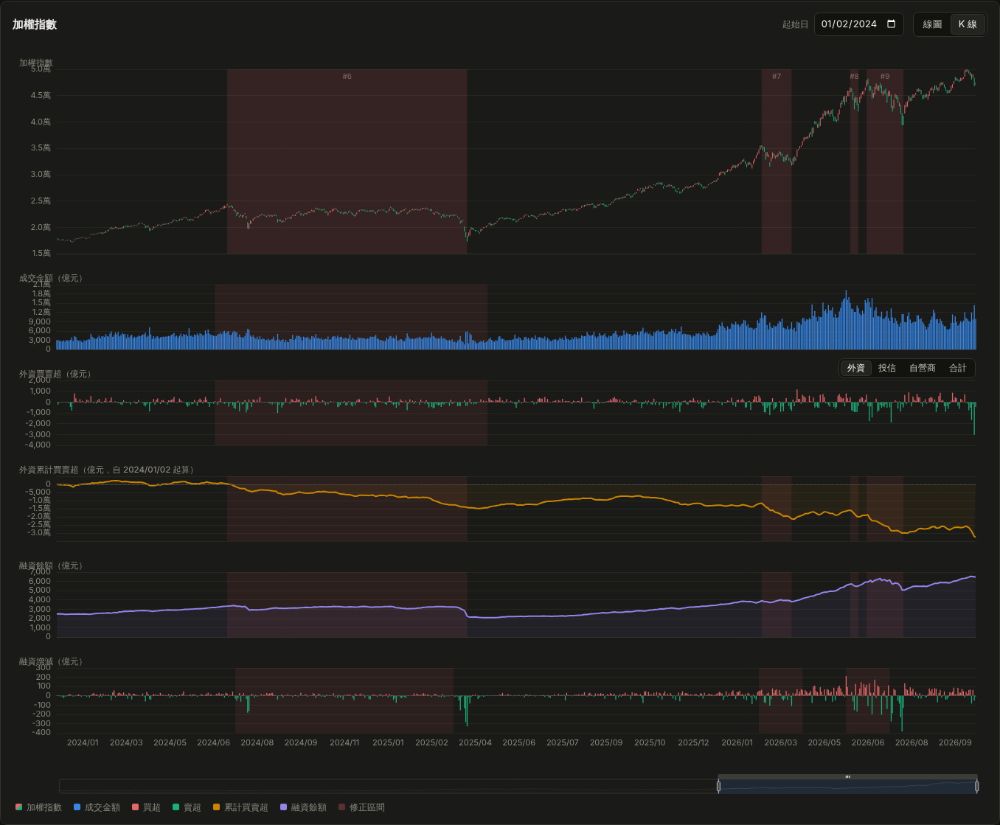

# TAIEX Drawdown Atlas · 台股大盤修正波段分析

**線上版：<https://tw-stock-drawdown.pages.dev>**

自 2017 年以來加權指數的每一次修正波段（峰谷法偵測），疊上成交金額、三大法人買賣超與
融資餘額。資料全部來自臺灣證券交易所公開 endpoint；**不使用任何模擬資料**，抓不到就報錯、
網頁拒絕渲染。



```
fetch_data.py   →   data/taiex-daily.{json,js}   →   index.html
```

> 程式碼與註解一律使用英文，介面與本文件使用中文。

## 快速開始

```bash
./run.sh                 # 增量抓取資料，再起本機伺服器 http://localhost:3001
./run.sh --no-fetch      # 跳過抓取，直接用現有資料
./run.sh deploy          # 發佈到 Cloudflare Pages（需先 wrangler login）
```

首次抓取約 110 分鐘（三大法人與融資只能逐日查詢，需遵守 rate limit）；之後原始回應都快取在
`data/raw/`，每天只補新交易日，數秒完成。`index.html` 也可直接以 `file://` 開啟。
`python3 bundle.py` 會產生內嵌 ECharts 與資料的單檔離線版 `dist/taiex-atlas-standalone.html`。

### 每日更新（cron）

`update_data.sh` 負責加鎖、日誌輪替（`fetch.log`）與失敗通知；證交所約 19:00 發佈籌碼資料：

```cron
0 20 * * 1-5 /path/to/taiex-drawdown/update_data.sh --bundle --deploy --quiet
```

旗標：`--bundle` 重打包、`--commit` 資料有變才 commit、`--deploy` 發佈、`--start YYYY-MM`
限縮抓取範圍。部署只上傳 `index.html`、`detect.js`、`data/taiex-daily.js` 三個檔案；
專案名稱可用 `CF_PAGES_PROJECT` 覆寫。

## 資料來源

| 資料 | Endpoint | 查詢單位 |
|---|---|---|
| 加權指數日 K | `TAIEX/MI_5MINS_HIST` | 月 |
| 市場成交資訊 | `afterTrading/FMTQIK` | 月 |
| 三大法人買賣金額 | `fund/BFI82U` | **日** |
| 信用交易統計 | `marginTrading/MI_MARGN` | **日** |

髒數值（`--`、`X`、空字串）一律轉 `null`，絕不轉 `0`。外資 = 「外資及陸資」+「外資自營商」
（2022 年起拆兩列）。當月與近五日的「無資料」快取會自動重抓。

## 偵測規則

實作於 `detect.js`，網頁與 `verify.js` 共用：

1. 追蹤 running peak，回檔跌破門檻即進入修正，持續追蹤最低點。
2. **收復前高才算一波結束**——同一波途中的反彈不另計，所以 2022 年整段熊市只算一波。
3. 到序列結尾仍未收復 → `ongoing`。

門檻（5/7/10/15%）、價格基準（盤中 / 收盤）、收復容差與反彈切分都是頁面上的即時控制項。
預設 7% + 收盤價 + 嚴格收復。

- **谷底後 1M / 3M / 1Y**：自谷底收盤價起算 21 / 63 / 252 個交易日報酬；資料不足顯示「未滿」。
- **融資殺盤幅度** = 區間融資減幅(%) ÷ 指數跌幅(%)。> 1.5 通常代表融資籌碼清洗較徹底。

本專案只描述已發生的籌碼變化，不構成投資建議。

## 個股籌碼監控（`stock.html`）

追蹤 `stocks.txt` 觀察清單裡的個股，**不做波段 / 回撤分析**，只呈現籌碼：

| 面板 | 來源 | 頻率 |
|---|---|---|
| 日 K（含 MA5/20/60）、成交量 | TWSE `afterTrading/STOCK_DAY` | 日（按月查詢） |
| 三大法人買賣超（外資 / 投信 / 自營商，堆疊） | TWSE `fund/T86` | 日 |
| 融資增減、融資餘額 | TWSE `marginTrading/MI_MARGN`（ALL） | 日 |
| 股東人數、大戶人數（>400 張，提示框另列 >1000 張） | [神秘金字塔](https://norway.twsthr.info/StockHolders.aspx?stock=2327) | 週 |
| 主力買賣超、券商分點買賣超前 15 名（1/5/20/60 日） | [富邦 e-Broker](https://fubon-ebrokerdj.fbs.com.tw/z/zc/zco/zco_2327.djhtm) | 日 |

```bash
echo 2317 >> stocks.txt          # 加入觀察清單（第一檔為預設開啟；僅支援上市股票）
python3 fetch_stocks.py          # 預設抓 12 個月；--months 24 加深、--stocks 2327,2330 臨時指定
```

- 單位一律為**張**。T86 與融資每日為全市場一次查詢，快取只保留需要的欄位，清單上所有股票共用；
  新增股票只多出它自己的月 K、每日分點表與幾個網頁。首次抓 12 個月約 15–25 分鐘。
- 主力日序列：富邦序列只回溯約 45 個交易日，其餘以逐日分點表（自設區間查詢，過去日永久快取）回補；
  分點表也隨資料一起輸出，頁面上的**日期**欄可檢視任一交易日的籌碼與當日分點。
- 三大法人面板右上可分別開關外資 / 投信 / 自營商 / 合計；只開一項時以紅綠柱顯示。
- 預設開啟 2330（`stock.html#2327` 可直接開其他股票）。
- 集保股權分散在減資 / 分割當週會出現「1 人持有 100%」的佔位列，一律剔除。
- `run.sh`、`update_data.sh` 在 `stocks.txt` 存在時自動一併更新；個股抓取失敗只記警告，不影響大盤資料。

## 測試

```bash
npm install   # 只有 render 測試需要 jsdom + echarts；未安裝時該套件顯示 SKIP
npm test      # 全部；node tests/run.js detect 只跑名稱含 detect 的套件
```

| 套件 | 內容 |
|---|---|
| `tests/detect.test.js` | 演算法規則，跑在手工序列上 |
| `tests/fetch_test.py` | 抓取腳本的解析與快取（不連網） |
| `tests/stock_fetch_test.py` | 個股抓取的解析（不連網） |
| `tests/render.test.js` | 在 jsdom 中實際執行 `index.html` |
| `tests/bundle.test.js` | `dist/` 是否落後於來源 |
| `verify.js` | 真實資料完整性與已知波段比對 |

## 檔案

```
fetch_data.py    抓取 + 快取 + 合併
fetch_stocks.py  個股抓取（stocks.txt 觀察清單）
detect.js        修正波段偵測
verify.js        資料與演算法驗證
index.html       大盤儀表板（CDN 載入 ECharts）
stock.html       個股籌碼頁
bundle.py        打包單檔離線 HTML
run.sh           本機抓取 + 伺服器 / deploy
update_data.sh   cron 每日更新
docs/            README 截圖
tests/           測試與執行器
```
